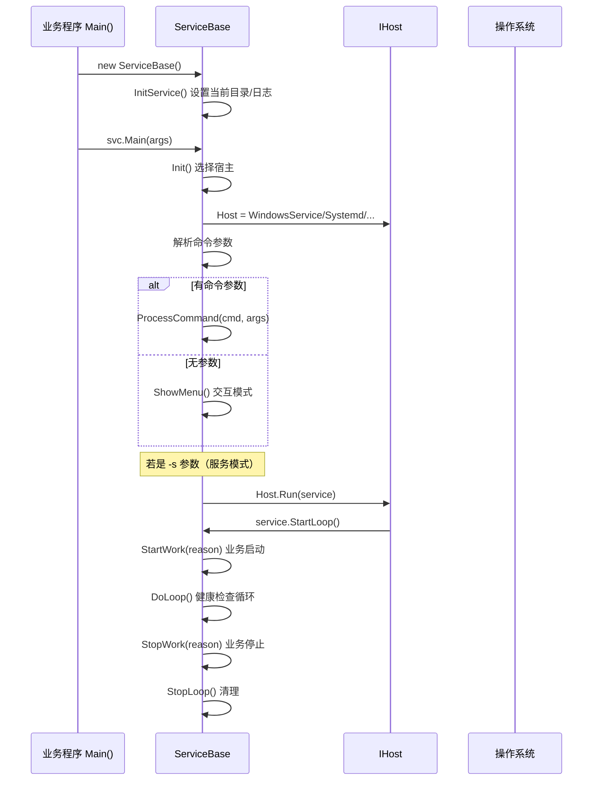
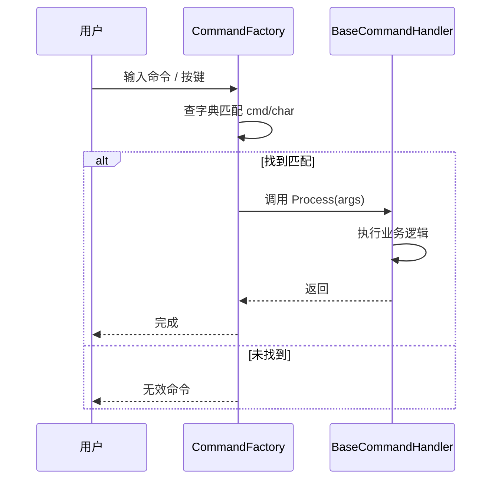
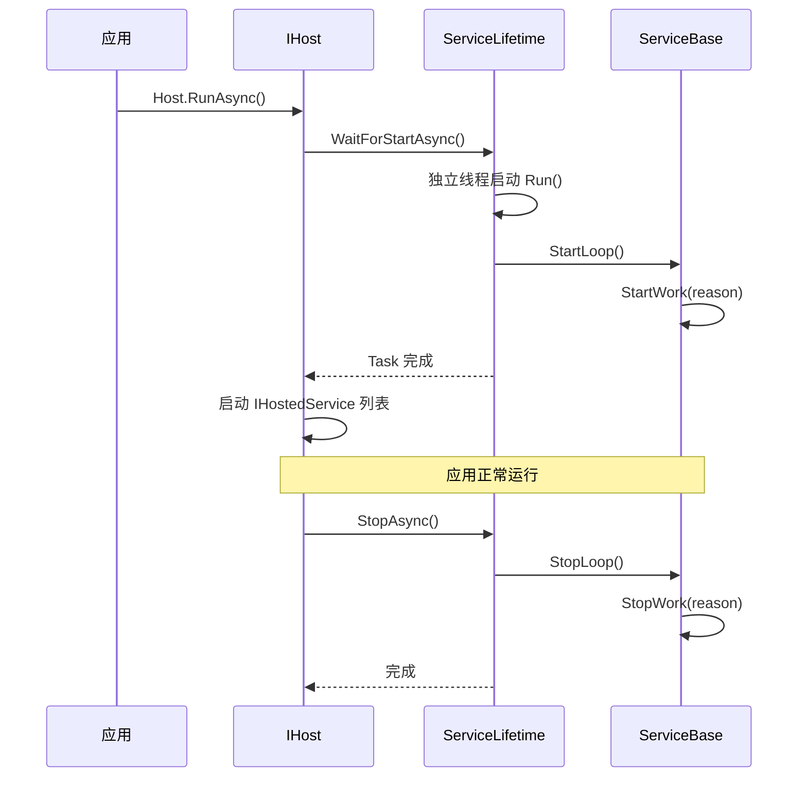
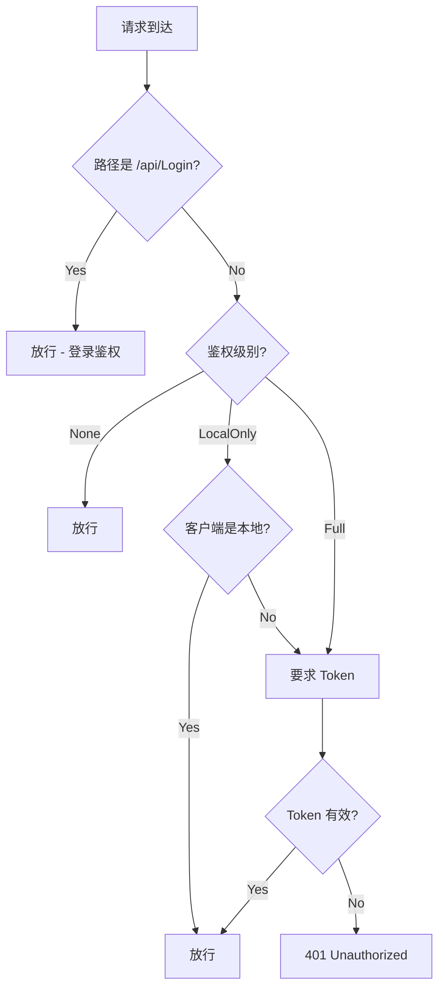

# NewLife.Agent 架构设计

> 版本：v1.0 | 日期：2026-07-15
> 需求对应：[需求文档](需求文档.md) | 功能清单：[功能清单](功能清单.md)

## 1. 整体架构

### 1.1 分层架构

```
┌─────────────────────────────────────────────────────┐
│                    业务应用层                         │
│   控制台应用 / ASP.NET Core / Worker Service / 其它   │
└──────────────┬──────────────────────────────────────┘
               │ 继承 ServiceBase / 调用 UseAgentService()
┌──────────────▼──────────────────────────────────────┐
│              NewLife.Agent 框架层                     │
│  ┌────────────────────────────────────────────────┐ │
│  │             服务抽象层 ServiceBase               │ │
│  │   ServiceName / Running / StartWork / StopWork  │ │
│  │   Main() → Init() → DoLoop() → 健康检查          │ │
│  └──────────────┬─────────────────────────────────┘ │
│  ┌──────────────▼─────────────────────────────────┐ │
│  │             宿主抽象层 IHost / DefaultHost       │ │
│  │   Install / Remove / Start / Stop / Restart     │ │
│  │   IsInstalled / IsRunning / Run / QueryConfig   │ │
│  └──────────────┬─────────────────────────────────┘ │
│  ┌──────────────▼─────────────────────────────────┐ │
│  │             平台实现层                           │ │
│  │  WindowsService / WindowsAutorun / Systemd      │ │
│  │  Procd / RcInit / SysVinit / OSXLaunch         │ │
│  └──────────────┬─────────────────────────────────┘ │
│  ┌──────────────▼─────────────────────────────────┐ │
│  │             命令执行层                           │ │
│  │  CommandFactory → BaseCommandHandler 派生类     │ │
│  │  反射自动发现 / 命令映射 / 冲突检测 / 菜单可见性  │ │
│  └────────────────────────────────────────────────┘ │
│  ┌────────────────────────────────────────────────┐ │
│  │           Web 管理面板层                        │ │
│  │  AgentWebPanel (HttpServer) → ApiController    │ │
│  │  默认全量鉴权 / 登录防护 / 扩展面板 / 静态文件  │ │
│  └────────────────────────────────────────────────┘ │
│  ┌────────────────────────────────────────────────┐ │
│  │             配置模型层                           │ │
│  │  Setting / ServiceModel / ServiceConfig         │ │
│  │  SystemdSetting / Menu / PanelExtension        │ │
│  └────────────────────────────────────────────────┘ │
└─────────────────────────────────────────────────────┘
┌─────────────────────────────────────────────────────┐
│                NewLife.Core 基础库                    │
│  日志(XTrace) / 配置(Config<T>) / 网络(HttpServer)   │
│  反射(AssemblyX) / 定时器(TimerX) / 内存池           │
└─────────────────────────────────────────────────────┘
```

### 1.2 设计原则

| 原则 | 说明 |
|------|------|
| **面向继承** | 业务程序只需继承 `ServiceBase`，重写 `StartWork`/`StopWork` |
| **面向组合** | 平台能力通过 `IHost` 对象组合到 `ServiceBase`，不耦合业务代码 |
| **面向运维** | 命令与监控能力内置，无需额外守护包装器 |
| **单一事实源** | `Setting.Current` 作为统一配置入口，代码构造与配置文件双向同步 |
| **跨平台抽象** | `IHost` 接口统一服务管理操作，各平台实现差异封装在派生类中 |

## 2. M1 平台工具类

### 2.1 职责

提供辅助工具类，支撑其他模块的跨平台能力。

### 2.2 核心组件

| 组件 | 所在工程 | 说明 |
|------|----------|------|
| `ServiceHelper` | NewLife.Agent | 运行时检测（dotnet/java）、工作目录分析 |
| `ServiceModel` | NewLife.Agent | 服务安装数据模型 |
| `ServiceConfig` | NewLife.Agent | 服务查询配置模型 |
| `SystemdSetting` | NewLife.Agent | Systemd 配置生成 |
| `Advapi32` | NewLife.Agent | Windows SCM API P/Invoke |
| `Desktop` | NewLife.Agent | Windows 桌面进程启动 |
| `NativeMethods` | NewLife.Agent | Windows 内存整理 API |
| `PowerStatus` | NewLife.Agent | Windows 电源状态查询 |
| `Menu` | NewLife.Agent | 菜单模型 |

## 3. M2 配置管理

### 3.1 职责

统一管理服务配置，支持代码构造与配置文件的自动同步。

### 3.2 核心组件

| 组件 | 所在工程 | 说明 |
|------|----------|------|
| `Setting` | NewLife.Agent | 主配置类，继承 `Config<Setting>`，持久化到 `Agent.config` |
| `ServiceModel` | NewLife.Agent | 服务安装数据模型（ServiceName/DisplayName/FileName/Arguments 等） |
| `ServiceConfig` | NewLife.Agent | 服务查询数据模型（Name/DisplayName/FilePath/AutoStart 等） |
| `SystemdSetting` | NewLife.Agent | Systemd `.service` 文件配置模型，含 `Build()` 生成方法 |

### 3.3 配置初始化流程

```
ServiceBase 构造函数
  → Setting.Current 加载配置文件
  → 从代码属性赋值 ServiceName/DisplayName/Description
  → Init() 中双向同步：代码→配置→代码（配置优先）
  → 配置中缺失的值从程序集元数据补充
  → Setting.Save() 持久化
```

### 3.4 设计决策

| 决策 | 选项 | 选择 | 理由 |
|------|------|------|------|
| 配置格式 | XML / JSON | XML | `Config<T>` 基类的默认格式，向后兼容 |
| 热加载 | 自动 / 手动 | 自动 | `Config<T>` 内置文件监控热加载 |
| 语言配置 | 本库 `Setting.Language` / Core `NewLife.Setting.Language` | Core 全局配置 | 语言属于全进程设置，Core 已提供归一化、词表校验与保存即时生效；本库不再重复定义，`Agent.config` 中的 `Language` 不再生效（破坏性变更，改用 `Core.config` 或 `NewLife.Setting.Language`） |

## 4. M3 服务抽象与跨平台宿主

### 4.1 职责

提供统一的 `ServiceBase` 基类和跨平台宿主实现，隐藏操作系统服务管理差异。

### 4.2 核心组件

| 组件 | 所在工程 | 说明 |
|------|----------|------|
| `ServiceBase` | NewLife.Agent | 服务基类，统一入口 `Main()`、生命周期管理、健康检查调度 |
| `IHost` | NewLife.Agent | 宿主接口契约：安装/卸载/启停/状态查询 |
| `DefaultHost` | NewLife.Agent | 宿主角色的抽象基类，兜底实现 |
| `WindowsService` | NewLife.Agent | Windows SCM 服务，Win32 API 实现 |
| `WindowsAutorun` | NewLife.Agent | Windows 登录自启动，注册表 Run 项 |
| `Systemd` | NewLife.Agent | Linux systemd，`.service` 文件 + `systemctl` |
| `Procd` | NewLife.Agent | OpenWrt procd，init 脚本 + pid 文件 |
| `RcInit` | NewLife.Agent | 传统 Linux init.d，init 脚本 |
| `SysVinit` | NewLife.Agent | SysVinit 兼容识别 |
| `OSXLaunch` | NewLife.Agent | macOS LaunchAgent，plist + `launchctl` |

### 4.3 关键流程

#### 服务启动流程



#### 平台选择策略

```mermaid
flowchart TD
  A[ServiceBase.Init()] --> B{是否 Windows?}
  B -->|Yes| C{UseAutorun?}
  C -->|Yes| D[WindowsAutorun]
  C -->|No| E[WindowsService]
  B -->|No| F{是否 macOS?}
  F -->|Yes| G[OSXLaunch]
  F -->|No| H{Systemd 可用?}
  H -->|Yes| I[Systemd]
  H -->|No| J{Procd 可用?}
  J -->|Yes| K[Procd]
  J -->|No| L{RcInit 可用?}
  L -->|Yes| M[RcInit]
  L -->|No| N[DefaultHost 兜底]
```

## 5. M4 命令行运维体系

### 5.1 职责

提供"命令行 + 交互菜单"双模式运维入口，支持自动化和人工运维。

### 5.2 核心组件

| 组件 | 所在工程 | 说明 |
|------|----------|------|
| `ICommandHandler` | NewLife.Agent | 命令处理器接口契约 |
| `BaseCommandHandler` | NewLife.Agent | 命令处理器基类，含 `Cmd`/`Description`/`ShortcutKey` |
| `CommandFactory` | NewLife.Agent | 命令工厂：反射扫描、构建字典、处理分发 |
| `CommandConst` | NewLife.Agent | 命令常量定义 |
| `Menu` | NewLife.Agent | 菜单模型，含按键/名称/命令/回调 |

### 5.3 命令映射表

| 命令字符串 | 处理类 | 快捷键 | 菜单可见性条件 |
|-----------|--------|:------:|---------------|
| `-i` | `Install` | 2 | 服务未安装 |
| `-install` | `InstallAndStart` | — | 始终可见 |
| `-reinstall` | `Reinstall` | — | 始终可见 |
| `-u` | `Remove` | 2 | 服务已安装 |
| `-uninstall` | `Uninstall` | — | 始终可见 |
| `-start` | `Start` | 3 | 服务已安装且未运行 |
| `-stop` | `Stop` | 3 | 服务正在运行 |
| `-restart` | `Restart` | 4 | 服务正在运行 |
| `-status` | `ShowStatus` | 1 | 始终可见 |
| `-run` | `RunSimulation` | 5 | 始终可见 |
| `-s` | `RunService` | — | 不显示菜单 |
| `-watch` | `WatchDog` | 7 | 配置了守护服务列表 |

### 5.4 关键流程



### 5.5 扩展机制

自定义命令只需三步：

1. 新建类继承 `BaseCommandHandler(service)`
2. 构造函数中设置 `Cmd`、`Description`、`ShortcutKey`
3. 实现 `Process(String[] args)`

`CommandFactory` 在构造时通过反射自动发现所有 `BaseCommandHandler` 派生类，无需手动注册。子类型优先级高于基类型，支持覆盖框架内置命令。

## 6. M5 健康监控与自愈

### 6.1 职责

运行期监控进程健康指标，超标时自动重启实现自愈。

### 6.2 核心组件

| 组件 | 所在工程 | 说明 |
|------|----------|------|
| `ServiceBase.DoCheck()` | NewLife.Agent | 主检查循环调度 |
| `HealthMonitor` | NewLife.Agent | 健康检查**纯逻辑**组件：阈值判断（内存/线程/句柄）、自动重启时间判断、`RestartTimeRange` 解析；除非法范围告警外不含重启/日志副作用，可独立单元测试 |
| `ServiceBase.CheckMemory()` | NewLife.Agent | 内存阈值检查（虚方法签名不变，内部委托 `HealthMonitor`） |
| `ServiceBase.CheckThread()` | NewLife.Agent | 线程数检查（委托 `HealthMonitor`） |
| `ServiceBase.CheckHandle()` | NewLife.Agent | 句柄数检查（委托 `HealthMonitor`） |
| `ServiceBase.CheckAutoRestart()` | NewLife.Agent | 定时重启检查（委托 `HealthMonitor`） |
| `ServiceBase.FreeMemory()` | NewLife.Agent | 主动内存整理 |

> 设计说明：`HealthMonitor` 只承载"判断"逻辑（`IsMemoryOver`/`IsThreadOver`/`IsHandleOver`/`IsAutoRestartDue`/`TryParseTimeRange`），
> 重启与日志副作用保留在 `ServiceBase` 虚方法中，子类重写钩子不受影响，公共 API 完全兼容。

### 6.3 关键流程

```mermaid
sequenceDiagram
  participant Loop as DoLoop()
  participant Check as DoCheck()
  participant Restart as Host.Restart()
  participant OS as 操作系统

  Loop->>Check: 按 WatchInterval 周期调用
  Check->>Check: CheckMemory() 检查工作集内存
  alt 超标
    Check->>Restart: Host.Restart()
    Restart->>OS: 重启进程
    Check-->>Loop: return (退出循环)
  end
  Check->>Check: CheckThread() 检查线程数
  alt 超标
    Check->>Restart: Host.Restart()
    Check-->>Loop: return
  end
  Check->>Check: CheckHandle() 检查句柄数
  alt 超标
    Check->>Restart: Host.Restart()
    Check-->>Loop: return
  end
  Check->>Check: CheckAutoRestart() 定时重启
  alt 到达时间
    Check->>Restart: Host.Restart()
    Check-->>Loop: return
  end
  Check->>Check: 看门狗检查
  Check->>WatchDog: 拉起被守护服务
  Check-->>Loop: 继续循环
```

### 6.4 设计决策

| 决策 | 选项 | 选择 | 理由 |
|------|------|------|------|
| 自愈方式 | 外部进程重启 / 内部线程重启 | 外部进程重启 | 内存泄漏/线程泄漏等问题内部无法彻底恢复，外部重启更彻底 |
| 重启策略 | 立即重启 / 窗口内重启 | 窗口内重启 | `RestartTimeRange` 支持限制重启时段（含跨零点），格式非法时安全地禁用自动重启并告警，避免高峰期意外重启 |
| 看门狗实现 | 内嵌检查 / 独立进程 | 内嵌检查 | 简化部署，无需额外进程 |

## 7. M6 Host 集成扩展

### 7.1 职责

桥接 NewLife.Agent 与 `Microsoft.Extensions.Hosting`，使 ASP.NET Core / Worker Service 应用可无缝切换为系统服务。

### 7.2 核心组件

| 组件 | 所在工程 | 说明 |
|------|----------|------|
| `ServiceLifetime` | NewLife.Extensions.Hosting.AgentService | 继承 `ServiceBase` + 实现 `IHostLifetime` |
| `ServiceLifetimeHostBuilderExtensions` | NewLife.Extensions.Hosting.AgentService | `UseAgentService()` 扩展方法 |
| `ServiceLifetimeOptions` | NewLife.Extensions.Hosting.AgentService | Options 模式配置服务元数据 |

### 7.3 生命周期桥接



### 7.4 设计决策

| 决策 | 选项 | 选择 | 理由 |
|------|------|------|------|
| 集成方式 | 继承 ServiceBase / 扩展方法 | 扩展方法 | 不侵入 HostBuilder 原有链式调用风格 |
| 生命周期实现 | 直接实现 IHostLifetime / 适配器模式 | 继承 ServiceBase + 实现 IHostLifetime | 复用 ServiceBase 全部能力 |

## 8. M7 Web 管理面板

### 8.1 职责

提供基于浏览器的服务运维界面，无需登录服务器即可查看状态、执行操作。

### 8.2 核心组件

| 组件 | 所在工程 | 说明 |
|------|----------|------|
| `AgentWebPanel` | NewLife.Agent | Web 面板主类，管理 HttpServer 生命周期、路由注册、Token 管理 |
| `ServiceBase.CreateWebPanel()` | NewLife.Agent | 虚拟工厂方法，子类重写以返回自定义 `AgentWebPanel` 实例 |
| `ApiController` | NewLife.Agent | RESTful API 控制器，处理状态/控制/配置/日志/鉴权请求 |
| `PanelExtension` | NewLife.Agent | 扩展面板数据模型，支持第三方注册自定义面板页 |
| `LoginRateLimiter` | NewLife.Agent | 登录爆破防护，基于 IP 的失败计数与临时封锁 |
| `DiskMonitor` | NewLife.Agent | 跨平台磁盘 IOPS 采集 |
| `PdhHelper` | NewLife.Agent | Windows PDH API 封装 |

### 8.3 API 路由

```
/api/Login        POST  登录鉴权，签发 Bearer Token
/api/Status       GET   获取服务状态
/api/Control      POST  启停控制 (start/stop/restart)
/api/ConfigMetadata GET 获取配置元数据（三列布局）
/api/UpdateConfig POST  更新配置（白名单，密码除外）
/api/ChangePassword POST 修改密码（校验旧密码）
/api/Logs         GET   读取日志（支持文件/行数/级别过滤）
/api/LogFiles     GET   获取日志文件列表
/api/WatchDog     GET   获取看门狗监控的服务状态列表
/api/Extensions   GET   获取扩展面板列表
/api/Health       GET   获取健康指标（内存/线程/句柄/GC 等）
/api/Languages    GET   获取界面语言列表与当前固定语言
/api/SetLanguage  POST  设置界面与日志语言（写入 Core 配置，空值恢复自动识别）
/*                GET   静态文件（内嵌 index.html / favicon.ico）
```

### 8.4 鉴权机制



### 8.5 路由注册规则

```
精确匹配优先于通配符：
/api/* → ApiController（控制器自行鉴权，Login 不鉴权）
/*     → 静态文件（内嵌资源 fallback）
```

### 8.6 设计决策

| 决策 | 选项 | 选择 | 理由 |
|------|------|------|------|
| Web 服务器 | 内置 HttpServer / Kestrel 独立进程 | 内置 HttpServer | 零额外依赖，与主进程同生命周期 |
| 前端方案 | 内嵌 SPA / 后端渲染 | 内嵌 HTML | 简化部署，一个 DLL 包含全部资源 |
| 鉴权方案 | Session / JWT / Bearer Token | Bearer Token | 无状态、适合 AJAX 调用、实现简单 |
| 口令保存 | 明文 / 自实现哈希 / 可插拔散列 | 可插拔散列（默认 PBKDF2-SHA256，600000 次迭代，兼容旧哈希） | 复用 `NewLife.Security.IPasswordProvider`；PBKDF2 是 NIST SP 800-132 标准化的慢哈希，OWASP 对 PBKDF2-HMAC-SHA256 的建议工作因子为 600000；历史明文与 `$sha512$` 等旧哈希首次登录自动升级，工作因子落后的 PBKDF2 哈希按新因子重新散列。派生实现按目标框架分流：.NET 6+ 用 `Rfc2898DeriveBytes.Pbkdf2`（实测单次 600000 次迭代 293 ms、零分配），net45/netstandard 保留手写循环（368 ms、约 64 MB 分配）；两者输出一致，由"标准实现生成密文 → 本实现验证"的单测锁定 |
| 传输安全 | 内置自签 TLS / 交由反向代理 | 交由反代或 SSH 隧道 | 自签证书浏览器必然告警，形同虚设；面板只负责认证授权 |
| 面板暴露面 | 逐方法自写鉴权 / 默认全量鉴权 | 默认全量鉴权 | 面板等同管理员权限，逐方法写容易漏；中间件兜底覆盖下游扩展 |
| 监听地址变更 | 重启服务 / 进程内重绑 | 进程内热重启 HttpServer | `NetServer.Stop` 清空监听后按新地址重建，无需重启应用 |

### 8.7 安全模型

面板具备服务控制、配置查看与日志读取能力，**等同于管理员权限**，而下游（如 StarAgent）常以系统服务身份运行并追加更多能力。因此安全设计的首要目标是**默认不暴露**，而不是堆防护手段。

#### 三道防线

| 防线 | 触发点 | 行为 |
|------|--------|------|
| 默认回环 | `WebBind` 默认 `127.0.0.1` | 只有本机可访问；改为 `*` 或具体 IP 才对外监听 |
| 默认全量鉴权 | 每个请求 | 除 `/`、`/index.html`、`/favicon.ico`、`/i18n/*`、`/api/Login`、`/api/Languages`、`/api/SetupStatus`、`/api/Setup` 外一律要求 Bearer Token，未登录直接 401；下游扩展控制器自动纳入 |
| 默认口令门闸 | 启动 / 开放远程时 | ① 首次启动口令仍为 `admin` 或空 → 仅在回环地址进入首次设置页，用户在浏览器里设置管理员口令；设置完成前默认口令不能登录，不生成随机口令或额外文件；多用户服务器建议先在配置中设好口令，避免同机其他用户抢先设置；② 非回环监听必须显式设置 `AllowInsecureRemote=true`，且必须先在配置中设置非默认口令，否则拒绝启动；③ 配置面板把 `WebBind` 改为非回环时同样要求该开关且不允许默认口令；④ 忘记口令时清空配置中的 `WebPassword` 并重启，重新进入设置页 |

#### 口令存储

口令统一由 `AgentWebPanel.PasswordProvider`（默认 `Pbkdf2PasswordProvider`，编码 `$pbkdf2-sha256$迭代次数$盐$哈希`，默认 600000 次迭代，取自 OWASP 对 PBKDF2-HMAC-SHA256 的建议工作因子）散列后写入配置，面板不再保存明文。配置文件中直接填写明文同样可用，**首次登录成功后自动升级为 PBKDF2 哈希**；旧版 `$sha512$...` 哈希也会在登录成功后自动升级；工作因子低于当前配置的 PBKDF2 哈希同样会在登录成功后重新散列。

默认选择 PBKDF2 而不是 Argon2id/bcrypt：全部目标框架（net45~net11）无需第三方依赖即可实现，且 PBKDF2 有 NIST 标准与 FIPS-140 认证实现；Argon2id 抗 GPU 更强，但需要引入原生或第三方包，与 Agent 零额外依赖的定位冲突，确有更高要求时可通过 `PasswordProvider` 扩展点替换。

首次启动没有口令时只在回环地址显示设置页，由用户自行设置；设置页接口只接受本机直接访问，拒绝反代转发头和非本机 Host/Origin，并用自定义请求头防止跨站提交。忘记口令时清空配置中的 `WebPassword` 并重启服务即可重新进入设置页，不再使用初始口令文件或 `-resetpwd` 命令。

#### 远程访问推荐路径

1. 本机完成首次设置 → 修改口令 → 再把 `WebBind` 改为 `*` 或具体 IP（热重启，无需重启服务）；
2. 更推荐：面板保持回环监听，通过 Nginx/Caddy 反向代理或 SSH 隧道对外提供 HTTPS；
3. 框架不内置 TLS 证书管理；确需在非回环地址以明文 HTTP 直连时，必须在配置文件中显式设置 `AllowInsecureRemote=true`（不在面板可写白名单内），并接受口令/令牌明文过网的风险。

登录限速以 TCP 连接对端 IP 为键。面板默认回环监听时，反代后的所有用户共用 `127.0.0.1`，连错几次会误锁全员；因此提供 `WebTrustForwardedFor`（默认 `false`）。开启后仅当连接来自回环时才采用 `X-Forwarded-For` 首个地址；由于本机任意客户端都能伪造该头，只在前面有可信反代并覆盖该头时开启，否则保持关闭。

#### 监听地址热重启

`UpdateConfig` 发现 `WebBind`/`WebPort` 变化后调用 `AgentWebPanel.RequestRebind()`：先返回响应（含新端口/监听范围），延迟 800ms 后在后台执行 `Server.Stop → 改地址端口 → Server.Start`。启动成功才落盘配置；新端口占用等失败场景回滚到原监听并记录错误日志。端口变化使 origin 改变，前端跳转到新地址后需重新登录（`localStorage` 按 origin 隔离）。

### 8.8 扩展机制

Web 面板采用"模板方法模式"设计，子类通过重写以下成员实现定制。

#### 扩展点汇总

| 扩展点 | 类型 | 默认值 | 用途 |
|--------|------|--------|------|
| `ServiceBase.CreateWebPanel()` | `virtual` 工厂方法 | `new AgentWebPanel(service)` | 子类返回自定义 `AgentWebPanel` 派生类 |
| `AgentWebPanel.PasswordProvider` | 可写属性 | `Pbkdf2PasswordProvider` | 替换口令散列算法（Argon2 等） |
| `AgentWebPanel.OnAuthenticate()` | `virtual` 方法 | 用户名 + 口令散列校验 | 接入域账号、单点登录等外部认证 |
| `AgentWebPanel.CheckSecurity()` | `virtual` 方法 | 非回环需 `AllowInsecureRemote` 且非默认口令 | 调整启动安全阈值 |
| `AgentWebPanel.IsPublicPath()` | `virtual` 方法 | 登录页/静态资源/登录与语言接口 | 追加匿名路径白名单 |
| `EmbeddedResourcePrefix` | `virtual` 属性 | `NewLife.Agent.WebPanel.wwwroot` | 替换嵌入资源命名空间前缀 |
| `EmbeddedResourceAssemblyType` | `virtual` 属性 | `typeof(AgentWebPanel)` | 替换嵌入资源所在程序集 |
| `RegisterRoutes()` | `virtual` 方法 | 注册 `ApiController` + 嵌入式静态文件 | 子类先 call base 再追加自定义控制器 |
| `GetExtensions()` | `virtual` 方法 | 返回空列表 | 注册扩展面板 Tab |

#### 面板实例工厂

`ServiceBase.StartWork()` 调用 `CreateWebPanel(this)` 创建面板实例，子类可重写以返回自定义子类：

```csharp
protected override AgentWebPanel CreateWebPanel(ServiceBase service)
{
    return new StarAgentService(service);
}
```

#### 认证与散列扩展

```csharp
// 接入域账号：无需框架配置，重写认证钩子即可
protected override Boolean OnAuthenticate(String user, String password, String remoteIp) =>
    DomainAuth.Validate(user, password);

// 使用更强的散列算法
protected override AgentWebPanel CreateWebPanel(ServiceBase service) =>
    new AgentWebPanel(service) { PasswordProvider = new Pbkdf2PasswordProvider() };
```

#### 嵌入式资源替换

```csharp
protected override String EmbeddedResourcePrefix => "StarAgent.WebPanel.wwwroot";
protected override Type EmbeddedResourceAssemblyType => typeof(StarAgentService);
```

`RegisterRoutes()` 内部使用上述两个属性，子类无需重写整个路由注册方法即可替换全部静态文件（含 `index.html`）。

#### 附加控制器

```csharp
protected override void RegisterRoutes()
{
    base.RegisterRoutes();
    Server.MapController<StarAgentController>("/api/agent");
}
```

#### 扩展面板 Tab

`GetExtensions()` 返回 `PanelExtension` 列表，前端动态渲染为导航 Tab：

```csharp
protected override List<PanelExtension> GetExtensions() =>
[
    new() { Id = "apps", Name = "应用管理", Icon = "📦", ApiEndpoint = "/api/agent/apps", Order = 10 }
];
```

> 跨程序集重写 `protected internal virtual` 成员时必须声明为 `protected`（C# 约束，编译器 CS0507 校验）。
> 扩展项序列化键名由面板 JsonOptions 统一为 camelCase（`id`/`name`/`icon`/`apiEndpoint`/`order`/`mode`）：面板启动时显式固定 `JsonHelper.Default.Options.PropertyNaming = CamelCase`，前端 `index.html` 按 camelCase 读取。

## 9. 关键设计决策

| 决策 | 选项 | 选择 | 理由 |
|------|------|------|------|
| 服务基类模式 | 继承式 / Fluent API 委托式 | 继承式 | 与 .NET 原生 `BackgroundService` 风格一致，学习成本低 |
| 跨平台宿主发现 | 静态检测 / 运行时检测 | 运行时静态检测 | 编译时即可确定可用宿主，避免运行时异常 |
| 内建命令处理器发现 | 手动注册 / 反射自动发现 / 静态工厂登记 | 静态工厂登记（内建）+ 反射发现（自定义扩展） | NativeAOT 裁剪后反射扫描会静默丢失内建命令；自定义扩展保留反射发现 |
| Web 面板鉴权 | 无鉴权 / 简单鉴权 / Token | Token Bearer | 无状态、安全、适合 RESTful API |
| 服务停止语义 | 单一 `Running` 标志 / 独立停止请求标志 | 独立 `_stopRequested` + 业务启动标记 | 停止请求可能早于巡检循环启动（服务处于启动挂起阶段被停止），只靠 `Running` 会静默丢弃该请求，导致「SCM 显示已停止而进程仍在跑且停不下来」；业务标记用于与 `StopWork` 配对，避免对未启动的业务调用停止逻辑 |
| Windows 启动握手超时 | 固定短等待提示 / 长等待提示 + 周期续报 | 30 秒等待提示 + 挂起期间每 200~2000 毫秒续报并推进检查点 | SCM 在等待提示到期前收不到状态更新，就判定启动超时并直接终止进程，且该终止不计为失败退出，配置的失败恢复动作不会触发，服务永久停在 Stopped；冷启动含程序集加载、JIT、配置加载、插件扫描、网络探测，耗时可达数秒，而 `StartLoop` 自身就允许阻塞 3 秒，固定短提示必然踩线 |
| 健康检查重启节奏 | 每轮巡检即重启 / 固定冷却 | 固定冷却 60 秒，日志仅在真正发起重启时输出；定时重启后运行计时与冷却基准同步归零 | 阈值持续超标时无冷却会让 systemd 每 `WatchInterval`（默认 10 秒）重启一次，形成重启风暴；冷却基准取自运行计时，若定时重启只归零运行计时而不归零基准，差值恒为负数，内存/句柄/线程超限触发的重启会被屏蔽到运行时长重新超过旧值为止 |
| 面板可写配置范围 | 黑名单（密码/密钥） / 白名单 | 白名单 | `AfterStart` 会在服务启动时执行命令，`ServiceName`/`DisplayName` 会拼接进服务控制命令与以 root 执行的启动脚本；黑名单漏一个字段就等于给面板用户一个持久化命令执行入口 |
| 平台启动脚本生成 | 直接字符串拼接 / 单行值清洗 + 系统 API | 单行值清洗 + 系统 API | 描述等单行值里的换行会把后续内容顶出键值行，并在以 root 执行的脚本里注入命令；权限设置改用 `File.SetUnixFileMode`（.NET 7+）并校验结果，避免 `chmod` 子进程失败被忽略而“安装成功但脚本不可执行” |
| pid 文件信任度 | 直接信任 pid 内容 / 启动时间交叉校验 | 启动时间交叉校验 | 进程异常退出后 pid 文件会残留，系统可能把同一 PID 分配给无关进程；对比进程启动时间与 pid 文件写入时间，晚于写入时间即判定陈旧并删除，避免 `Stop` 误杀无关进程 |
| macOS plist 保活 | 无条件 `KeepAlive` / 默认不保活 | 默认不输出 `KeepAlive`，仅依赖网络时用 `NetworkState` | `launchctl stop` 发 SIGTERM 终止进程，若配置了无条件 `KeepAlive`，launchd 会立刻重新拉起，停服命令看起来成功但服务马上又回来；崩溃自愈由 Agent 自身的看门狗与自动重启负责 |
| 面板系统采样 | 每次请求实时采样 / 短周期缓存 | 2 秒缓存 + 降级限频 | 前端每 10 秒轮询，多个标签页同时打开会线性放大系统调用；Windows 上 PDH 不可用时 WMIC 降级每次都会创建子进程，故对降级路径单独做 30 秒限频 |
| 配置管理 | 硬编码 / 配置文件 / 双向同步 | 双向同步 | 代码提供默认值，配置文件覆盖，持久化保留 |
| Systemd 文件 | 手动创建 / 自动生成 | 自动生成 | 安装服务时自动写入 `.service` 文件 |
| 日志 | 控制台 / 文本文件 / 数据库 | 文本文件 + 控制台 | 使用 `XTrace` 统一日志，Web 面板可在线查看 |
| 前端框架 | Vue / React / 原生 HTML | 原生 HTML | 零依赖、一个 DLL 包含全部资源、无需 node_modules |

## 10. NativeAOT 适配

`net8.0+` 目标支持 NativeAOT 发布（裁剪 + 无 JIT），并常驻启用 `IsAotCompatible` 分析器，0 告警为构建期硬约束；`net40`~`netstandard` 老目标不受影响。

### 10.1 关键机制

| 机制 | 位置 | 说明 |
|------|------|------|
| 内建命令静态登记 | `Command/CommandHandlerFactory.cs` | 内建处理器由静态工厂实例化，不再依赖 `Assembly.GetTypes` 反射扫描（NativeAOT 裁剪后该扫描会静默丢失命令） |
| 响应 DTO 与元数据保留 | `WebPanel/ApiModels.cs`、`WebPanel/AotRoots.cs` | 面板响应统一 DTO 化，`DynamicDependency` 显式保留属性可枚举性 |
| 配置模型反射保留 | `WebPanel/AotRoots.cs` | `DynamicDependency` 保留 `NewLife.Setting` 与 `NewLife.Net.SocketSetting` 的公开成员；Core 的配置绑定只按运行时类型反射，缺根时 `Core.config`/`Socket.config` 写不出任何节点，语言切换既不持久化，遇到已有空配置节还会抛 `XmlWriter` 异常 |
| JSON 源生成 | `WebPanel/AgentJsonContext.cs` | `[JsonSerializable]` 源生成叠加 `JsonHelper` 成员访问表，JIT/AOT 双端免反射序列化 |
| 委托封送泛型化 | `Windows/MarshalHelper.cs` | net5+ 使用泛型重载消除动态封送（IL3050），旧目标条件编译回退 |
| 可执行路径适配 | `WindowsService.cs` | 单文件/AOT 下回退 `Environment.ProcessPath`，裁剪边界显式声明 |

### 10.2 扩展性与约束

自定义命令处理器仍通过扩展程序集反射发现；NativeAOT 场景需调用方保证类型元数据保留（显式保留或改用静态注册）。新增面板响应 DTO 必须同步登记 `AotRoots` 与 JSON 上下文，仓库内有防漂移单元测试。

### 10.3 CI 验证

CI 分为“单元测试矩阵 + AOT 矩阵”两个工作流，均在 push/PR 触发并支持 `workflow_dispatch` 手动运行；不设夜间计划任务（代码可能十天半个月才同步到 GitHub，定时跑没有意义）。

`test.yml` 的单元测试矩阵覆盖 win-x64（windows-latest）、linux-x64（ubuntu-latest，采集 XPlat 代码覆盖率并上传 artifact）、linux-arm64（ubuntu-24.04-arm，原生 Arm64 runner）与 linux-loongarch64（qemu-loongarch64 用户态仿真），全部执行完整用例集；另有 `build` 作业（windows-latest）做全解决方案编译校验。

`aot.yml` 的 `aot` 矩阵作业按目标平台覆盖：主要目标 win-x64、linux-x64、linux-arm64（原生 Arm64 runner）、linux-musl-x64（x64 交叉构建）发布后真实运行 `-status` 冒烟断言输出完整，并追加 `-panel` 冒烟（启动 Web 面板自检首页内嵌资源与 i18n 词表、面板 DTO 序列化、全局配置反射与语言切换落盘，输出 `AOT_PANEL_PROBE=OK` 为通过）；次要目标 linux-arm（x64 交叉构建）、linux-musl-arm64、linux-musl-arm（仅发布验证）、osx-x64（macos-15-intel）、osx-arm64（macos-15）做发布验证；`aot-analyzer` 作业以 `-warnaserror` 守住 net8.0 目标的 AOT/裁剪分析器 0 告警；`aot-loongarch64` 作业经 loongnix 源做非 AOT 的自包含发布（官方 nuget.org 无该 RID 包，NativeAOT 缺目标运行时包），并在 QEMU 仿真下真实运行 `-status` 冒烟。

LA64 仿真环境由复合 action `.github/actions/loong64-qemu` 统一提供：宿主安装 `qemu-user-static`（binfmt_misc 注册 loongarch64，F 标志使 chroot 内透明执行），用 `debootstrap` 构建 Debian sid 的 loong64 rootfs（loong64 已并入 Debian 官方归档），安装龙芯 .NET SDK（github.com/loongson/dotnet），再把工作区与 /proc、/sys、/dev 挂载进 rootfs 供 chroot 内构建与运行。

CI 运行器全部固定为 `ubuntu-24.04` / `ubuntu-24.04-arm` 等明确版本，不使用 `ubuntu-latest`：交叉工具链与 loong64 仿真步骤依赖宿主 apt 源与软件包版本，镜像自动漂移会让这些「改造宿主环境」的步骤静默失效。loong64 复合 action 与各交叉工具链安装步骤开启 `set -x` 并给 apt 加 `Acquire::Retries`，失败时可直接看到具体子命令；`-status`/`-panel` 冒烟失败时额外输出 `file`/`ldd`，便于判别缺库或链接到 glibc。

linux-musl-x64 的冒烟放在 `alpine` 容器内执行，而不是直接跑在 ubuntu 宿主上：musl 产物只能加载 musl 版运行库，宿主只有 glibc 版 `libssl`，面板启动即验证口令，OpenSSL 垫片加载失败会以 `No usable version of libssl was found` 直接 SIGABRT（退出码 134）。容器内跑即等同真实部署环境；ICU 同理无法从宿主动态加载，仍靠 RID 固定的 `InvariantGlobalization` 规避。该 RID 因此没有具体语言数据：`-panel` 冒烟照常校验语言切换接口，但跳过“首页按目标语言渲染”的断言（其余 RID 保留完整断言）。

LA64 作业有两个仿真环境适配点：一是**仿真内不跑 MSBuild**（龙芯 SDK 的 NativeAOT MSBuild 在 QEMU 下偶发反射桩缺陷），改为宿主原生构建、chroot 内只运行；二是**关闭 W^X 双映射**（`DOTNET_EnableWriteXorExecute=0`），否则 LA64 运行时在 QEMU 下使用写执行分离代码页会随机崩溃（testhost SIGSEGV 或异常分发阶段 FailFast）。该开关已在 QEMU 8.2/10.0.13 与 LA64 运行时 10.0.12/10.0.13 上交叉验证，关闭后 326 个用例全量稳定通过。此外单测作业用官方 VSTest 控制台（18.8.1 起支持 LoongArch64 架构识别，SDK 自带的 18.7 会在取进程架构时抛异常）。

本地交叉构建需在 NuGet 配置补充 loongnix 源（`https://nuget.loongnix.cn/v3/index.json`，资源端点为 http，需 `allowInsecureConnections`）；该源为 BaGet 实现、对不存在的包返回 500，须用 `packageSourceMapping` 逐包精确限定 loongarch64 包（通配写法会被误判为匹配全部包），否则常规包查询会被牵连失败。

---

> **文档版本**：v1.0  
> **创建日期**：2026-07-15  
> **关联文档**：[需求文档](需求文档.md)、[功能清单](功能清单.md)、[使用与运维手册](./Agent-使用与运维手册.md)
